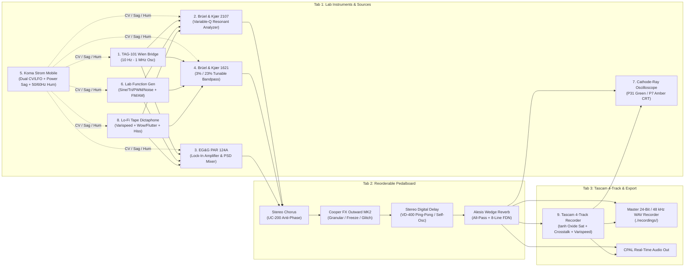

# KlangBench — Modular Audio Generation & Vintage Test Equipment Workstation

[](https://github.com/voidwave-lab/KlangBench/actions/workflows/ci.yml)

**KlangBench** is a high-performance, real-time modular audio synthesis, vintage laboratory test-equipment emulation, stereo pedalboard, and 4-track cassette recording workstation written in Rust.

Drawing inspiration from electronic music pioneers and experimental test-equipment setups (such as Hainbach, mid-century Brüel & Kjær acoustic analyzers, EG&G Princeton Applied Research lock-in amplifiers, micro-cassette tape loops, and boutique granular/FDN effects), KlangBench provides a **dual-interface architecture**:
- **Terminal User Interface (TUI)** powered by `ratatui` and `crossterm` with real-time Unicode Braille CRT oscilloscope rendering and ballistic VU meters.
- **Embedded Web GUI** served locally via `axum` and WebSockets (`http://127.0.0.1:8080`), featuring retro industrial instrument panels, phosphor-glow HTML5 Canvas oscilloscopes, illuminated analog needle meters, and drag-and-drop sample loading.

---

## Signal Flow & System Architecture



---

## Emulated Modules

### Tab 1: `[LAB INSTRUMENTS & SOURCES]`
1. **TAG-101 Audio Signal Generator**:
   - Wien bridge analog oscillator emulation with incandescent thermistor AGC settling envelope.
   - `10 Hz` to `1 MHz` across switchable decade multipliers (`x1`, `x10`, `x100`, `x1k`, `x10k`, `x100k`) with continuous `10–100` dial tuning.
   - Pure low-distortion sine wave and PolyBLEP fast rise-time square wave.
   - Step attenuator (`0 dB` to `-50 dB` in `10 dB` steps), fine output level potentiometer, and output transformer saturation above `0 dBV`.
2. **Brüel & Kjær 2107 Frequency Analyzer**:
   - Cascaded ultra-narrow variable-Q Butterworth resonant bandpass filter (`Q` up to `120+`).
   - Input sensitivity stage (`-20 dB` to `+40 dB`) with discrete soft-clipping and overload indicator.
   - Electromechanical ballistic meter emulation (switchable **Slow RMS** and **Fast Peak** modes with 2nd-order damped needle inertia).
3. **EG&G Princeton Applied Research Model 124A Lock-In Amplifier**:
   - **Input Stage**: Direct FET vs. Transformer coupling with simulated thermal & $1/f$ flicker noise floor contours.
   - **Signal Channel Filter**: `FLAT`, `BANDPASS` ($Q \in [1, 100]$), `NOTCH` (cascaded `-80 dB` rejection), `LOW PASS` (`12 dB/oct`), and `HIGH PASS`.
   - **Phase Sensitive Detector (PSD) & Phase Shifter**: Synchronous demodulation reference mixer with 4-quadrant selector (`0°`, `90°`, `180°`, `270°`) and continuous `0–100°` 10-turn vernier dial.
   - **Output Low-Pass Filter & Dynamic Reserve**: 12 time constants (`1 ms` to `300 s`), switchable `6 dB/oct` and `12 dB/oct` slopes, `LO DRIFT` / `NORMAL` / `HI DYNAMIC RESERVE` (`1000x`), and Pre-PSD & DC Output overload detection.
4. **Brüel & Kjær Type 1621 Tunable Band Pass Filter**:
   - Selectable `3%` narrow ($Q \approx 33.3$), `23%` 1/3-octave ISO R 266 ($Q \approx 4.35$), and `Linear` bypass modes across 5 contiguous frequency decades (`0.2–2 Hz` to `2k–20 kHz`).
   - Realistic `+90°` to `-90°` resonant phase shift calculation, `0.2 V RMS` vs. `1.0 V RMS` input voltage range with overload lamp, and manual dial or automated internal ramp sweep.
5. **Koma Elektronik Strom Mobile Emulation**:
   - Dual LFO/CV channels (`Sine`, `Triangle`, `Ramp`, `Sample & Hold`) routable to instrument frequencies and filter cutoffs.
   - Virtual `3.0 V – 9.0 V` power supply sag simulation and `50/60 Hz` mains hum + rectifier ripple injection.
6. **General Purpose Laboratory Function Generator**:
   - Waveforms: `Sine`, `Triangle`, `Square` (with variable PWM `5%–95%`), `Sawtooth`, `Ramp`, `White Noise`, and 7-state `Pink Noise`.
   - Linear and Logarithmic Frequency Modulation (FM), Amplitude Modulation (AM), and DC offset bias.
7. **Visual Cathode-Ray Oscilloscope**:
   - Real-time triggered dual-trace oscilloscope (`Timebase ms/div`, `Voltage V/div`, `Auto` / `Normal` / `Rising Edge` / `Falling Edge` trigger with adjustable threshold, and switchable **P31 Green** / **P7 Amber** CRT phosphor persistence).
8. **Lo-Fi Tape Micro-Sampler / Dictaphone**:
   - Drag-and-drop or file-path loading of `.wav`, `.mp3`, and `.flac` samples via `symphonia`, plus 3 built-in procedural laboratory tape loops.
   - Varispeed (`±2 octaves`), reverse playback, `300 Hz – 3.8 kHz` micro-cassette bandpass filter, dual sinusoidal + stochastic jitter wow & flutter, oxide tape hiss, and magnetic head saturation compression.

### Tab 2: `[PEDALBOARD / EFFECT CHAIN]`
A modular, dynamically reorderable 4-slot stereo FX rack with individual stomp bypass switches:
1. **Stereo Chorus (Behringer Ultra Chorus UC-200 style)**: Dual modulated delay lines (`5–30 ms`) driven by anti-phase LFOs with `Rate`, `Depth`, `Tone/EQ`, and `Wet/Dry` controls.
2. **Stereo Digital Delay (Behringer Vintage Delay VD-400 style)**: `10 ms` to `1500 ms` delay time with stereo ping-pong mode, high-cut & low-cut feedback damping filters, and soft-limited self-oscillation above `100%` feedback.
3. **Cooper FX Outward MK2 Emulation**: Micro-looping overlapping Hann-windowed granular processor with `Grain Size` (`5–500 ms`), `Grain Pitch Shifter` (`-12` to `+12` semitones), and `Time Stretch`, `Freeze`, and `Glitch/Stutter` modes.
4. **Alesis Wedge Reverb Emulation**: Vintage 90s algorithmic desktop reverb featuring a variable pre-delay line, 4-stage Schroeder all-pass input diffusion network, and an 8-line Hadamard Feedback Delay Network (FDN) with prime delay lengths and high-frequency damping.

### Tab 3: `[TASCAM 4-TRACK RECORDER & SESSIONS]`
- **Tascam Portastudio 4-Track Cassette Mixer**: 4 concurrent audio tracks with per-channel `Rec Arm`, `Input Source Selector`, `Level Trim`, `Stereo Pan`, `Mute`, `Solo`, and dedicated analog VU meters.
- **Tape DSP**: Non-linear magnetic oxide saturation (`tanh(k * x)`), head HF smoothing, and an inter-track crosstalk matrix simulating adjacent head bleed (`1↔2`, `2↔3`, `3↔4`).
- **Global Tape Transport**: `Play`, `Stop`, `Fast Forward`, `Rewind`, and global `Varispeed` (`±15%`).
- **Master Session WAV Recorder**: Lock-free `rtrb` ring buffer feeding a background writer thread that exports uncompressed stereo **24-bit / 48 kHz WAV** files to `./recordings/`.

---

## Project Structure

```text
KlangBench/
├── Cargo.toml
├── LICENSE
├── README.md
├── .gitignore
├── recordings/              # Stereo 24-bit / 48 kHz WAV session exports
│   └── .gitkeep
└── src/
    ├── main.rs              # CLI entrypoint, dual-UI orchestration, unit tests
    ├── dsp/
    │   ├── mod.rs           # Zero-delay feedback SVF filters, ballistic meters, saturation, Symphonia loader
    │   ├── instruments.rs   # Tab 1: All 8 vintage laboratory instruments & sound sources
    │   ├── pedals.rs        # Tab 2: Modular reorderable 4-pedal stereo FX rack
    │   └── tascam.rs        # Tab 3: Tascam-style 4-track cassette recorder with crosstalk & varispeed
    ├── engine/
    │   └── mod.rs           # Real-time CPAL stream, lock-free command & rtrb WAV recording threads
    ├── tui/
    │   └── mod.rs           # Ratatui + Crossterm terminal user interface with Braille CRT scope
    └── web/
        ├── mod.rs           # Embedded Axum HTTP + WebSocket telemetry server & multipart sample loader
        └── index.html       # Retro industrial HTML5/Canvas/CSS laboratory workstation GUI
```

---

## Setup & Run Instructions

### Prerequisites
- **Rust** (`1.75+`, stable toolchain)
- Native audio output backend (CoreAudio on macOS, ALSA/PipeWire/PulseAudio on Linux, WASAPI on Windows)

### 1. Build and Run (TUI + Web GUI Simultaneously)
```bash
cargo run --release
```
- Starts the real-time `cpal` DSP engine, launches the interactive `ratatui` **Terminal User Interface**, and serves the **Web GUI** at **[http://127.0.0.1:8080](http://127.0.0.1:8080)**.

### 2. Optional Command-Line Flags
```bash
# Run in Web-GUI-only mode (without terminal raw mode TUI) on a custom port:
cargo run --release -- --headless --port 8080

# Run automated engine & 24-bit WAV recording self-test:
cargo run --release -- --self-test
```

### 3. Run Unit Tests
```bash
cargo test --release
```

---

## Keyboard Shortcuts (TUI & Web UI)

| Key | Action |
| :--- | :--- |
| `1`, `2`, `3` | Switch between **Tab 1 (Lab Instruments)**, **Tab 2 (Pedalboard)**, and **Tab 3 (Tascam 4-Track)** |
| `j` / `k` or `↑` / `↓` or `Tab` | Navigate between instrument parameters |
| `h` / `l` or `←` / `→` or `Enter` | Fine-adjust knob value or toggle switch / cycle mode |
| `H` / `L` or `PageDown` / `PageUp` | Coarse-adjust parameter value |
| `Space` or `R` | Start / Stop **Master Session Recording** (`./recordings/klangbench_YYYYMMDD_HHMMSS.wav`) |
| `[` / `]` | Reorder FX pedals in the signal chain |
| `f` or `/` | Load a custom `.wav`, `.mp3`, or `.flac` file into the Dictaphone micro-sampler |
| `q` or `Ctrl+C` | Exit KlangBench cleanly |

---

## License

This project is licensed under the **GNU General Public License v3.0** ([GPL-3.0](LICENSE)).
